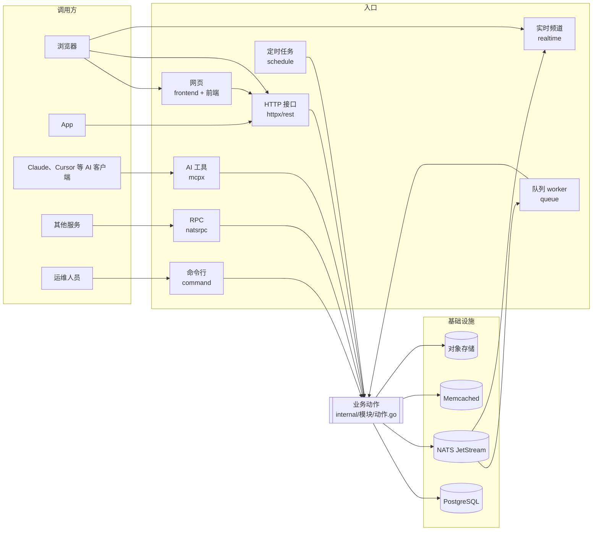
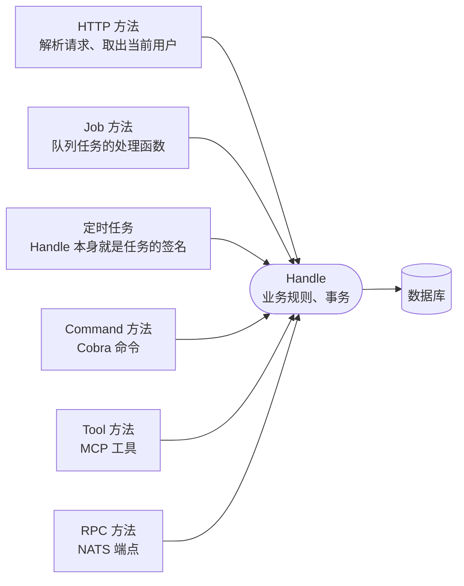
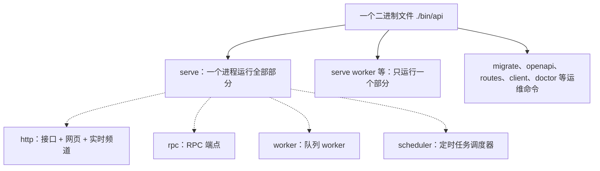
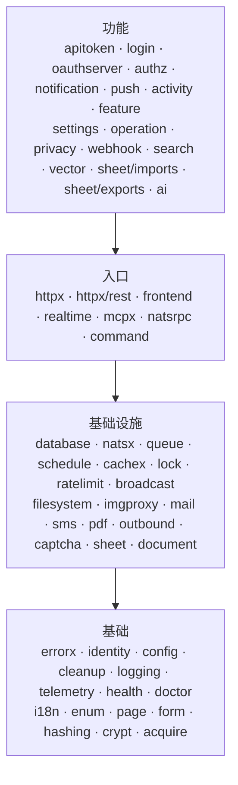
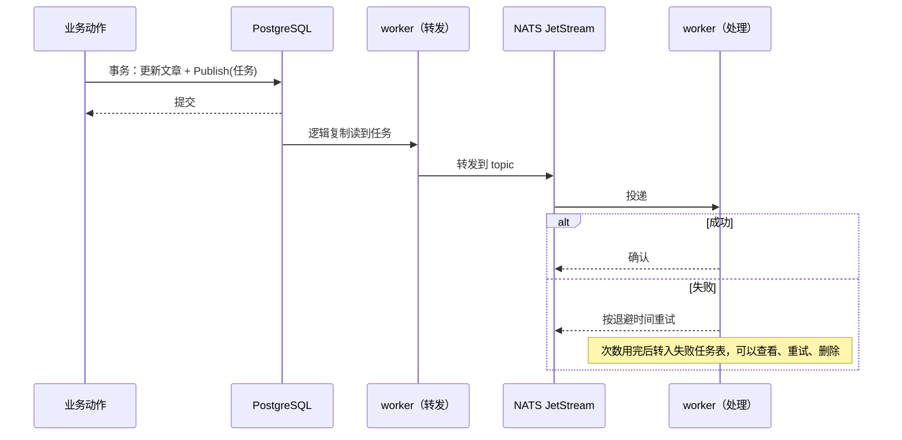
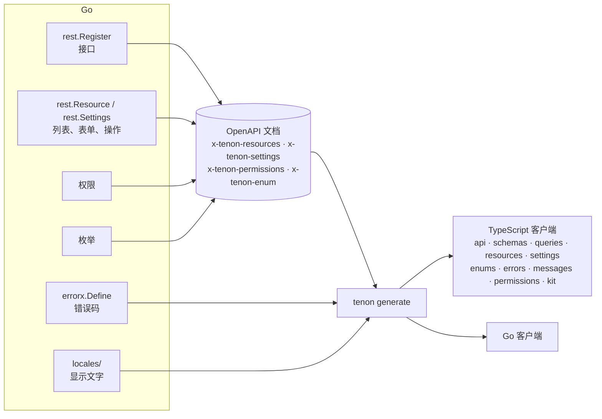
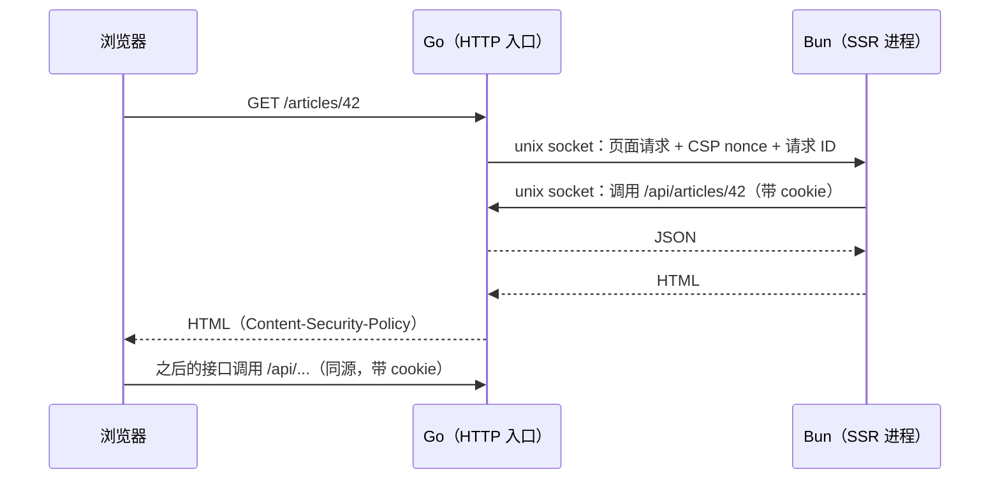
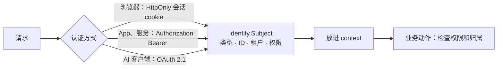

# Tenon

Tenon 是一个用 Go 构建后端服务的框架。业务逻辑写成**业务动作**（action），HTTP 接口、网页、队列任务、定时任务、命令行、AI 工具和 RPC 都是调用它的入口；网页用 React、Mantine 和 TanStack Start 编写，与 App 调用同一组接口，整个应用编译成一个二进制文件部署。

它为配置、路由、验证、错误处理、日志、认证、数据库、迁移、队列和前端提供一套统一的约定，同时直接使用社区组件的原生能力：chi 与 Huma、slog、Bun ORM 与 pgx、goose、Cobra、go-i18n、cockroachdb/errors、NATS、Mantine、TanStack Router / Query / Start。

## 设计原则

- **依赖一目了然**：没有服务容器和全局状态，所有依赖都通过普通的构造函数显式传递，在入口中按顺序创建。
- **一个动作一个文件**：每个业务动作是一个小类型，只依赖它真正用到的东西；各种入口都是它的方法。
- **约定开箱即用**：请求 ID、统一的错误响应、强制声明每个接口的访问策略、带稳定错误码的业务错误。
- **按需引入**：框架的包分为四层，每个包都可以单独使用；只处理队列的后台服务不需要 HTTP 相关的包。
- **元数据与语言无关**：接口、资源、权限、枚举都写进 OpenAPI 文档，任何语言的客户端都能读到，TypeScript 和 Go 客户端由它生成。
- **一个二进制文件**：前端编译后嵌入 Go 程序；一个进程可以运行全部部分，也可以按部分分开部署。

## 整体架构

请求从不同的入口进来，最终调用同一组业务动作；业务动作通过基础设施的包访问外部资源。



基础设施是固定的一套，每个组件只做最擅长的事：

| 组件 | 做什么 |
| --- | --- |
| PostgreSQL | 业务数据；队列任务的发件箱（经逻辑复制转发）；原子锁、限流计数、全文搜索 |
| NATS JetStream | 任务队列、实例之间的广播、在线成员、服务之间的 RPC |
| Memcached | 先读缓存再加载的缓存 |
| 对象存储（S3 或本地磁盘） | 上传的文件，浏览器直传 |
| Gotenberg（可选） | 把前端打印模板渲染的 HTML 转成 PDF |
| Qdrant（可选） | 向量检索 |

## 业务动作

“发布文章”是 `internal/article/publish.go` 中的 `article.Publish`：一个保存依赖的结构体、一个构造函数、一个执行业务的 `Handle` 方法。HTTP 接口、队列任务、命令行等入口都是同一个类型上的方法，它们把各自的输入转换后调用 `Handle`：

```go
// Publish 发布文章。
type Publish struct{ db *bun.DB }

func NewPublish(db *bun.DB) *Publish { return &Publish{db: db} }

// Handle 发布一篇草稿：只有作者能发布，每篇只发布一次。
func (a *Publish) Handle(ctx context.Context, subject identity.Subject, id uuid.UUID) (*Article, error) {
    // 在事务中读取、检查、更新，并在同一个事务中发布通知任务
}
```



- 构造函数只**保存**依赖，执行时才**使用**它们。所以生成接口文档、列出路由、声明命令时，可以用零值的依赖构造动作，不用打开任何资源。
- 一个动作完成后需要同步执行的后续动作，用钩子在入口中连接；可以异步完成的，在同一个事务中发布队列任务。

## 应用的结构

一个功能完整的应用是这样的：

```text
blog/
├── cmd/api/main.go        程序入口：组装根命令
├── config/app.yaml        配置
├── internal/
│   ├── bootstrap/         装配：配置结构、打开资源、HTTP 服务、worker、调度器、命令
│   └── article/           业务模块：一个动作一个文件
├── migrations/            SQL 迁移（含发布过来的框架迁移）
├── locales/               翻译文件：错误提示、字段和枚举的显示文字
├── apps/                  前端，每个一个目录，例如 web、admin
└── packages/client/       生成的 TypeScript 客户端
```

`bootstrap` 中的 `App` 保存各部分共用的资源（数据库连接、NATS 连接、缓存等），HTTP 服务、队列 worker、定时任务调度器各是 `App` 的一个方法。程序的子命令只是选择运行哪些部分：



小型部署只运行 `serve`：一个进程、一份配置、一套资源。业务量增长后每个部分一个进程（`serve http`、`serve worker`、`serve scheduler`），各自按负载增减实例，代码不变。多个实例同时运行时，worker 竞争领取任务，调度器用锁保证每次触发只执行一次。

## 框架的包

框架的包分为四层，每个包只能导入同层或更低层的包。例如基础层的 `errorx` 不导入基础设施层的 `database`，在任何地方使用 `errorx` 都不会引入数据库。这条规则由架构测试 `internal/checks/archtest` 检查，新增的导入违反分层时测试失败。



| 层 | 作用 | 举例 |
| --- | --- | --- |
| 基础 | 不碰外部资源的通用部分，可以在任何地方使用 | `errorx` 带错误码的业务错误；`identity` 已认证的主体；`config` 读取并校验配置；`logging` 日志；`telemetry` 推送日志、指标、链路 |
| 基础设施 | 与外部资源打交道 | `database` 连接池与事务；`queue` 任务队列；`schedule` 定时任务；`lock` 原子锁；`filesystem` 文件；`mail`、`sms` 发送；`pdf` 生成 PDF |
| 入口 | 请求进入应用的方式 | `httpx/rest` 基于 Huma 的接口；`frontend` 托管前端和服务端渲染的进程；`realtime` WebSocket 频道；`mcpx` AI 工具；`natsrpc` RPC；`command` 命令行 |
| 功能 | 自带数据表的应用功能，由应用把路由和命令接进来 | 登录与注册、API 令牌、角色与权限、站内通知、操作日志、功能开关、设置、后台操作、注销与导出个人数据、Webhook、全文搜索、AI 助手 |

功能包的数据表随包内嵌迁移，`migrate publish` 把它们复制到应用的 `migrations/` 中，与应用自己的迁移一起执行。保存个人数据的功能包同时提供删除和导出，注销账号、导出个人数据时一并处理。

## 数据与后台任务

队列任务和业务数据**在同一个事务中发布**：`Publish` 把任务写进 PostgreSQL 的预写日志（WAL），事务提交后 worker 经由逻辑复制读到它，转发到 NATS JetStream；事务回滚时任务一起取消。所以“文章已发布”和“通知订阅者”总是同时生效、同时撤销：



- 每个任务**至少执行一次**，处理函数需要能安全地重复执行。
- 定时任务按 cron 表达式触发；多个实例同时运行时，每次触发只在一个实例上执行。每次执行写一条执行记录，也可以立即执行一次（经由队列交给 worker）。
- 后台操作（导入、导出、批量处理）记录状态和进度，前端用事件流显示进度。

## HTTP 接口与客户端

接口用 `rest.Register` 注册，基于 Huma：请求和响应是 Go 的结构体，标签声明验证规则，OpenAPI 文档随代码生成，也可以离线导出。

- **访问策略必须声明**：每个接口都要声明 `Public` 或 `RequireToken` 等认证方式，没有声明时启动失败。
- **统一的错误响应**：业务错误带稳定的错误码（例如 `article.not_found`），提示按请求的语言翻译；字段错误指出出错的位置。
- **请求 ID 和链路**：每个请求有请求 ID，日志、链路和错误响应中都带着它。

客户端需要的元数据都先写进 OpenAPI 文档，再由 `tenon generate` 生成客户端：



- 生成的 TypeScript 客户端按接口的操作 ID 分组（`article-publish` 生成 `api.article.publish`），附带与服务端一致的校验规则和提示、TanStack Query 的查询选项、资源和设置的定义。
- 客户端协议（认证、错误、分页、事件流、上传）与语言无关：认证用 `Authorization: Bearer` 或同源的会话 cookie，网页、App 和其他语言的客户端都按同一套规则实现。

## 前端

网页用 React、Mantine 和 TanStack Start 编写，放在应用的 `apps/` 中，每个前端一个目录，例如官网 `apps/web`、后台 `apps/admin`。框架提供三个前端包，随 Go 模块分发，`tenon` 把它们复制到项目的 `.tenon/js`：

| 包 | 作用 |
| --- | --- |
| `@go-tenon/client` | 客户端运行时：会话、错误分类、校验、分页、查询缓存随身份清空、上传、后台操作的进度、AI 对话。不依赖任何包和 DOM |
| `@go-tenon/start` | 把 TanStack Start 接到 Go：Vite 插件（挂载路径、服务端渲染或页面外壳）、编译 SSR 程序、请求头转交、CSP nonce |
| `@go-tenon/ui` | 基于 Mantine 的应用骨架和界面，分成五层：主题（`theme`）、应用骨架（`app`）、部件（`components`）、只描述样子的布局和登录页（`blocks`）、框架功能的前端（`features`），见[前端包的分层](docs/frontend/README.md#ui-layers) |

`@go-tenon/ui` 的布局、登录页和样式预设按界面的样子命名，与使用者是谁无关；权限、租户、身份是应用接进来的逻辑：

| 类别 | 组件 | 样子 |
| --- | --- | --- |
| 后台布局 | `FrameLayout` | 满宽的顶栏加左侧侧栏菜单，可开多标签，信息密集 |
| | `RailLayout` | 双栏导航：模块的图标栏加二级导航，设置从用户菜单进入 |
| 官网与文档 | `SiteLayout`、`DocsLayout` | 吸顶页头、导航、页脚；文档三栏 |
| 登录页 | `CenteredAuthLayout`、`SplitAuthLayout` | 居中卡片；左右分栏。与布局任意搭配，表单 `LoginForm` 与样式分开 |
| 样式预设 | `compact`、`comfortable`、`spacious` | 只管密度：紧凑、舒展、宽松 |

按 Go 中 `rest.Resource` 的声明，`ResourcePage` 渲染整个列表、筛选、新建、修改、删除和操作；队列、定时任务、导入导出、通知、后台操作、操作记录都有现成的组件。

网页由 Go 托管：前端构建后嵌入 Go 程序，Go 是唯一的 HTTP 入口，静态文件、预渲染的页面由 Go 直接返回。每个前端在 `package.json` 中声明是否在服务端渲染（`"tenon": { "base": "/admin/", "ssr": false }`）：

- 只在浏览器中渲染的前端，Go 返回页面外壳，页面由浏览器中的路由渲染；
- 服务端渲染的前端，页面请求经 unix socket 交给 Bun 渲染。全部 SSR 前端编进同一个 Bun 可执行文件，只在有 SSR 前端时才嵌入，没有时程序中不带 Bun。

渲染需要数据时，Bun 经另一个 unix socket 调用 Go 的接口，带上原请求的 cookie。Bun 不连数据库，也不持有密钥：



- 官网、文档这类公开页面在服务端渲染，不随请求变化的页面在构建时预渲染。
- 后台类的应用默认只在浏览器中渲染，程序中不需要 Bun。
- PDF 的打印模板也写成 React 组件，由 Bun 渲染成 HTML，再交给 Gotenberg 转成 PDF。

## 身份与安全



- **登录**：密码、验证码登录与注册，找回密码，二次验证，第三方登录，passkey；浏览器的登录凭据是 HttpOnly 的会话 cookie，页面上的脚本不接触它。
- **令牌**：API 令牌（不透明令牌与 JWT）；OAuth 2.1 授权服务器，供 MCP 远程连接器使用。
- **授权**：角色与权限，可以按租户分配；接口声明需要的权限，前端据此显示按钮和菜单。
- **多租户**：所有租户的数据在同一个数据库中，用租户 ID 区分，可以再用行级安全策略兜底。
- **其他**：密码哈希、用应用密钥加密和签名链接、按键限流、人机验证、只能访问公网地址的出站请求。

## 可观测性与运维

- **日志**：基于 slog，请求 ID、用户、链路等关联字段自动带上。
- **指标与链路**：用 OTLP 推送日志、指标和链路，网页的渲染和它调用的接口在同一条链路中。
- **健康检查**：就绪检查确认依赖可用，停机时先排空进行中的请求。
- **自检**：`doctor` 命令检查运行环境的版本、设置和权限，并给出修改方法。
- **运维接口**：队列的积压与失败任务、定时任务的执行记录都有接口和现成的后台页面。

## 开发工具

`go tool tenon` 是开发工具：

| 命令 | 做什么 |
| --- | --- |
| `tenon init` | 生成一个能直接运行的 Go + React 项目：一个挂在 `/` 的官网前端，带示例模块 |
| `tenon add frontend <名称>` | 再加一个前端：`--layout rail\|frame\|site` 选择布局，`--login centered\|split\|none` 选择登录页，`--preset compact\|comfortable\|spacious` 选择样式预设，`--render csr\|ssr` 选择渲染方式；四个选项互相独立，默认值随布局 |
| `tenon dev` | 运行应用和各前端的开发服务器；修改 Go 代码后重新编译、重启并重新生成客户端 |
| `tenon generate` | 编译应用，生成 TypeScript 和 Go 客户端 |
| `tenon build` | 构建前端（有服务端渲染的前端时连同 Bun 编译成 SSR 程序），编译出一个嵌入了它们的二进制文件 |

## 快速开始

需要 Go 1.27.4 或更高版本，以及 [Bun](https://bun.sh)。生成一个新项目（`todo` 是项目的目录名）：

```bash
go run github.com/go-tenon/tenon/cmd/tenon@main init todo
cd todo
bun run dev
```

在浏览器中打开 <http://localhost:8080>，页面和接口都在这个端口；接口文档在 <http://localhost:8080/api/docs>。

只想在已有的项目中使用框架的包：

```bash
go get github.com/go-tenon/tenon@main
```
